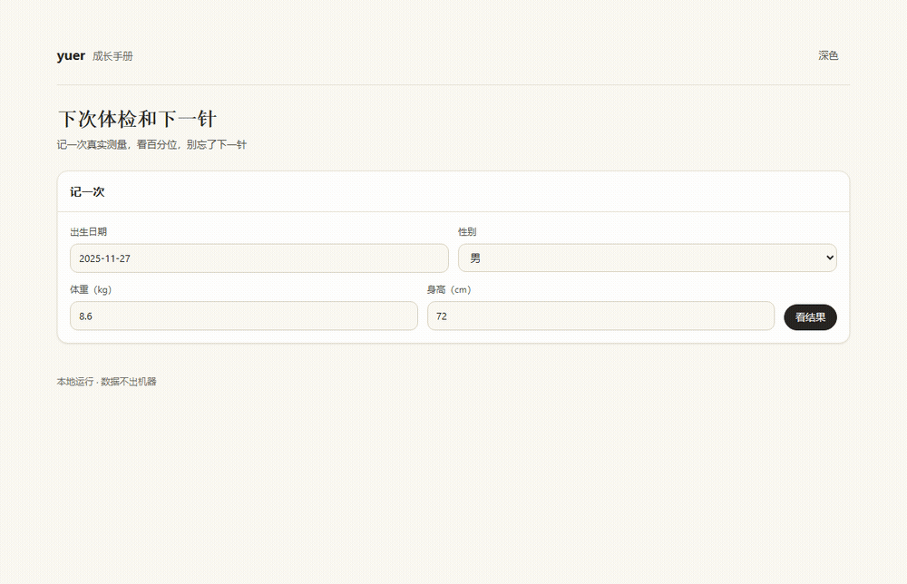
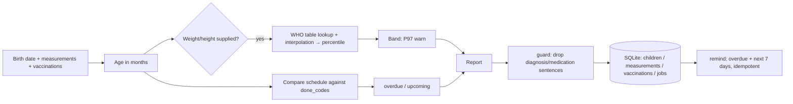

# yuer · child growth and vaccinations



Record height and weight once, watch the trend, and don't miss the next shot.

## Features

- **WHO percentiles**: sex-specific 0–60 month reference tables with linear interpolation; outputs P3 / P50 / P97 and a percentile.
- **Trend over single points**: one reading below P3 or above P97 only raises a finding (`growth.weight_band` / `growth.height_band`) and says to check three readings.
- **Vaccination plan**: 22 doses from the national immunisation schedule, 0–60 months; `vaccine.overdue` for missed doses, `vaccine.upcoming` for the next two months.
- **Due reminders**: `remind` collects overdue and due-within-7-days; the `jobs` table keeps it idempotent — one per day.
- **CSV export**: `export` writes date / weight / height / vaccine / dose for the paediatrician.
- **Summary guard**: parent-facing text passes `guard`; any sentence with diagnosis, medication, "possibly", "suspected" or "recommend" is dropped whole.

## Quick start

```bash
uv sync --extra dev
uv run yuer growth --birth 2025-11-27 --sex boy --weight 9.6 --height 75.0
uv run yuer vaccine --birth 2025-11-27
uv run yuer note --birth 2025-11-27 --weight 9.6     # guarded parent-facing note
uv run yuer serve        # http://127.0.0.1:8000
```

Measured on a 2025-11-27 birth at 12 months (2026-11-27) with 9.6 kg / 75 cm: weight P50.0, height P42.5, both in the normal band; the 12-month varicella dose is planned for 2026-11-27.
28 tests, 84% line coverage.

## Why not just ask a general model

Ask a general model "is 9.6 kg normal at 12 months" and you get a vague judgement, but:

1. **It can't interpolate** — percentiles need a table lookup plus interpolation, and it guesses a "normal range";
2. **It loses the month arithmetic** — doses are strictly by age; it will place the 8-month MMR at 12 months;
3. **It mixes sexes** — the curves differ;
4. **It oversteps** — it happily diagnoses and suggests medication, neither of which is allowed here.

yuer keeps tables and doses in code; the model only helps phrase questions for the clinic, and that text must pass the guard.

## Who it's for

- Parents of children aged 0–5;
- Anyone tracking vaccinations by age who fears missing a dose;
- People who want to show a paediatrician a trend instead of a string of numbers.

## Roadmap

- [ ] Corrected age for preterm infants
- [ ] Multiple child profiles (records are keyed by `child_id`; the CLI defaults to 1)
- [ ] Growth chart image export
- [ ] Fill records from a photo of the vaccination booklet

## FAQ

**Where does the data come from?**
Growth curves are an excerpt of the WHO Child Growth Standards (2006) for 0–60 months, linearly interpolated, so approximate. The schedule follows the national immunisation programme. Neither is medical advice; the clinic and paediatrician decide.

**Why only flag, not conclude?**
A single measurement swings with feeding, nappies and technique. This flags "high/low band" and always says to look at three readings — it does not replace a doctor.

**Will `remind` send twice?**
No. The key is `vaccine:<date>` in the `jobs` table; a second run reports "already reminded". Use `--force` to resend.

**What about my 0.x database?**
`yuer migrate --db data/yuer.db` backs up to `yuer.bak-<timestamp>.db` and converts the old `checks` table into a child plus measurements. The birth date is inferred backwards from the last age in months, so verify it once after migrating.

## Commands

```bash
yuer growth --birth 2025-11-27 [--sex boy|girl] [--weight kg] [--height cm] [--on DATE] [--save] [--json] [--db PATH]
yuer vaccine --birth 2025-11-27 [--on DATE] [--json] [--db PATH]
yuer mark --code mmr --dose 1 [--on DATE] [--db PATH]
yuer note --birth 2025-11-27 [--weight kg] [--height cm]      # guarded note
yuer remind [--force] [--db PATH]                             # overdue + 7 days, idempotent
yuer export [--child-id 1] [--out records.csv] [--db PATH]
yuer migrate [--db PATH]
yuer serve [--port 8000] [--db PATH]
yuer doctor [--db PATH]                                       # config / database / vaccine / llm / webhook
```

## Dependencies

Runtime: `fastapi`, `uvicorn`, `jinja2`, `python-multipart`, `pydantic` + `pydantic-settings` (prefix `YER_`), `httpx`, `typer` + `rich`, `sqlalchemy` + `alembic`.
Dev: `pytest`, `pytest-cov`, `ruff` (line-length 100), `mypy`.
Python ≥3.10; image `python:3.10-slim`, two-stage, `EXPOSE 8000`.

## How it works



Rules live in `domain/rules/` and `domain/guard.py`; storage and migration in `adapters/`; CLI and Web only render.

## Layout

```
yuer/
├── yuer/
│   ├── domain/          # models, engine, guard, summary, remind, rules/{percentile,vaccine}
│   ├── adapters/        # store.py, migrate.py
│   ├── iface/           # cli.py (Typer), web.py (FastAPI + Jinja2)
│   ├── config.py        # YER_ prefixed settings
│   └── doctor.py
├── migrations/          # alembic env + versions/0001_init.py
├── templates/
├── tests/               # 28 tests: interpolation / doses / remind / export / guard / migrate / iface
├── Dockerfile           # python:3.10-slim, EXPOSE 8000
└── .github/workflows/test.yml
```

## Author

shiyi · GitHub [@wushiyi105-jpg](https://github.com/wushiyi105-jpg) · wushiyi105@gmail.com
