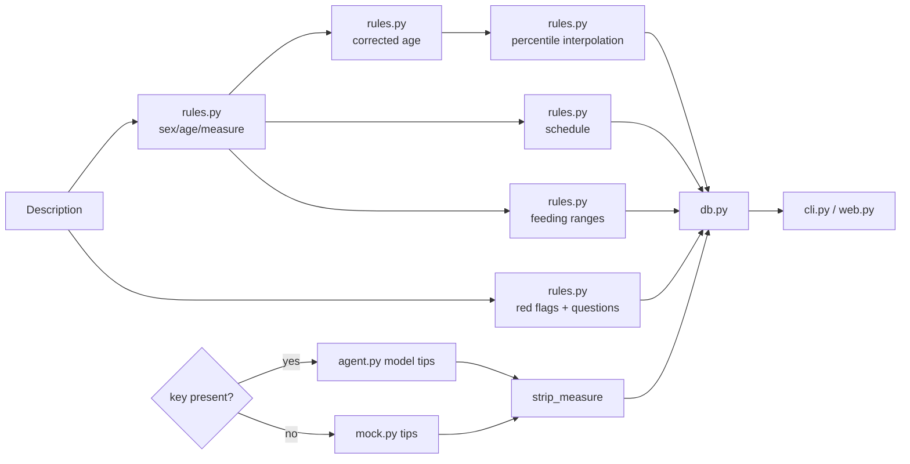

# YuEr · Baby Growth and Feeding Reference

[](https://github.com/wushiyi105-jpg/yuer/actions) []() [](./LICENSE) [](https://codecov.io/gh/wushiyi105-jpg/yuer)


> Give sex, age and measurements: see where the percentile falls, which vaccine is next, how to feed this month, and which symptoms are red flags.

Parents ask two things constantly: **is this height and weight normal**, and **which shot is due next month**. The first needs a month-by-month reference, the second needs a schedule. Neither should be answered by a group chat. This tool does interpolation, corrected age, the immunisation table and feeding ranges locally — reference and triage only, never diagnosis.

**CLI + Web, zero third-party dependencies.**

## ✨ Features

- 📏 **Percentile bands** — anchors at 0/3/6/9/12/18/24 months, linearly interpolated, with P3 / P15 / P50 / P85 / P97 and where this measurement lands
- 🧮 **Corrected age for preterm** — `corrected = chronological − (40 − gestational weeks) ÷ 4`, only under 37 weeks
- 💉 **13 national schedule entries** — hepatitis B, BCG, polio, DTaP, MMR, JE, meningococcal, hepatitis A, varicella, with self-paid items marked
- 🍼 **5 feeding stages** — milk only, purées, minced, three meals, three meals plus snacks
- 🚨 **7 red flags** — fever under 3 months, seizures, rapid breathing, lethargy, persistent vomiting, rash with fever, swallowed objects
- 🩺 **5 triage questions** — temperature, alertness, intake, urine output, duration
- 🔒 **Numbers stay local** — the model writes explanations only; age, cm, kg and temperature are stripped
- ⚠️ **No diagnosis** — reference bands and triage only, no medication or dosing

## 🚀 Quick start

```bash
git clone https://github.com/wushiyi105-jpg/yuer.git
cd yuer

cp .env.example .env      # optional: LLM_API_KEY

python -m yuer check --text "Boy, 8 months, weight 9kg, height 70cm, head 45cm"
```

Or keep it in `baby.txt` and run `python -m yuer check --file baby.txt --save`.

Docker:

```bash
docker build -t yuer .
docker run -p 8000:8000 yuer
```

## 📂 Real examples

Four descriptions and their outputs live in the repo; copy them to reproduce:

| Input | Where it came from | What to check |
|---|---|---|
| [`examples/case-01.txt`](examples/case-01.txt) | A community checkup sheet, an 8-month boy's numbers repeated verbatim | All three measures land in P15–P85; the word "thin" should not drive the verdict |
| [`examples/case-02.txt`](examples/case-02.txt) | A preterm follow-up group question, born at 32 weeks, now 6 months | Growth uses corrected 4.0 months; vaccines still follow chronological 6 months |
| [`examples/case-03.txt`](examples/case-03.txt) | A parent calling before the night ER, 2-year-old, 38.5°C, listless | A red flag must end at "see a doctor now" |
| [`examples/case-04.txt`](examples/case-04.txt) | A group follow-up, 15-month girl on milk only for a week | Refusing food is also a red flag; the checklist flags missing urine output |

```bash
python -m yuer --mock check --file examples/case-01.txt
```

Full outputs are archived under `examples/out/case-0N.md`; sources and expectations live in [`examples/cases.json`](examples/cases.json).

## 🤔 Why not just ask a general LLM

A general model says "9 kg at 8 months is normal". It cannot give the percentile, and it will not tell you the next dose is meningococcal at 9 months. Four differences:

1. **The landing point can be recomputed** — `rules.interpolate()` interpolates between 6 months (7.9 kg) and 9 months (8.9 kg) by `8/3` to get 8.6 kg, then applies spread factors for P3 6.4 / P15 7.4 / P85 9.9 / P97 11.0. 9 kg lands in P15–P85, a definite answer; "normal" is neither checkable nor bounded.
2. **Preterm uses corrected age** — 32 weeks, now 8 months chronological, is 6 months corrected, so the 6-month standard applies. `rules.preterm()` handles it in one line; models routinely skip it and call the baby small.
3. **The schedule is a table** — at 8 months, 8 doses are due, the next is meningococcal at 9 months, varicella at 12 (partly self-paid). 13 entries in `data/milestones.json`, so no missed dose and no free/paid confusion.
4. **Works offline** — percentiles, correction, schedule, feeding, red flags and questions are local; without a key you only lose the explanation.

## 🎯 Use cases

- **Before a well-child visit**: check the three landing points, and only ask about the one that is out of band.
- **Preterm follow-up**: assess by corrected age instead of scaring yourself with term standards.
- **Next month's shot**: due doses and the next three, with self-paid items marked.
- **Starting solids**: iron-fortified cereal, one food at a time, three days of observation.
- **Fever at night**: under 3 months is an immediate red flag; otherwise the 5 questions get the history straight for tomorrow.

## 🗺 Roadmap

- **Trend curves**: repeated measurements per child, flagging two consecutive bands crossed rather than a single point.
- **WHO tables**: replace estimated bands with official month-specific percentiles, with a data source.
- **Developmental milestones**: head control, rolling, sitting, crawling, walking ranges with warning signs.
- **Vaccine reminders**: concrete dates from birth date, including catch-up schedules.
- **Feeding log**: daily milk and solids intake against the monthly range.

## ❓ FAQ

**Are these official percentiles?**
The medians follow commonly used WHO values, interpolated by month; the bands are median × spread factors. They are for trends and out-of-band flags, **not the official percentile table**. This is stated in the `note` field of `data/growth.json`. Diagnosis belongs to your paediatrician.

**How is preterm calculated?**
`corrected = chronological − (40 − gestational weeks) ÷ 4`. 32 weeks, 8 months chronological → 6 months corrected; at 37 weeks or more, no correction.

**Why isn't fever at 8 months a red flag?**
The red flag is fever under 3 months. Fever alone at an older age is not an emergency, but lethargy, rapid breathing or seizures still trigger their own flags.

**Any medication advice?**
None. Reference bands, schedule and triage only. Antipyretics are dosed by weight and prescribed by your doctor.

**Will the model change the numbers?**
No. `agent.strip_measure()` replaces "8 months", "9kg", "45cm", "38 degrees" with a neutral phrase; numbers come only from local computation.

## 📖 Commands

```bash
# 👶 assess
python -m yuer check --text "..."
python -m yuer check --file baby.txt --save

# 💉 schedule
python -m yuer vaccines

# 🍼 feeding ranges
python -m yuer feeding

# 📏 percentile bands for a month
python -m yuer growth --month 8 --sex boys

# 🗂 history
python -m yuer history

# 🌐 web
python -m yuer web --port 8000

python -m yuer --json check --text "..."
python -m yuer --mock check --text "..."
```

## 🔌 Model configuration

Any **OpenAI-style `/chat/completions`** endpoint:

| Platform | `LLM_BASE_URL` | `LLM_MODEL` |
|---|---|---|
| DeepSeek (default) | `https://api.deepseek.com` | `deepseek-flash` |
| OpenAI | `https://api.openai.com/v1` | `gpt-4o-mini` |
| Local Ollama | `http://localhost:11434/v1` | `qwen2.5` |

## 🧠 How it works

```
sex / age / measurements / symptoms
  │
  ├─ rules.sex / age_months / measure
  ├─ rules.preterm ───── under 37 weeks → corrected age
  ├─ rules.interpolate anchors → P3–P97
  ├─ rules.classify ──── band bucket
  ├─ rules.vaccines ──── due / next three
  ├─ rules.feeding ───── five stages
  ├─ rules.red_flags ─── seven flags
  ├─ rules.questions ─── five triage questions
  │
  ├─ model: explanation / tips / risks (strip_measure)
  └─ offline: mock.py assembles from bands and flags
  │
  └─ SQLite → CLI / Web
```

### Data flow



## 🗂 Layout

```
yuer/
├── yuer/
│   ├── rules.py    # sex, age, measures, preterm, interpolation, bands, schedule
│   ├── agent.py    # orchestration + number stripping
│   ├── mock.py     # offline tips
│   ├── db.py       # assessments
│   ├── cli.py      # check / vaccines / feeding / growth / history / web
│   └── web.py      # single page + JSON API
├── data/growth.json     # anchor medians + spread factors
├── data/milestones.json # 13 vaccines + 5 feeding stages + 7 flags
├── examples/            # 4 real inputs + cases.json + out/ outputs
├── docs/regression-map.md # issue → test name
├── tests/test_yuer.py        # 34 unit tests
├── tests/test_integration.py # 22 integration tests
└── assets/demo.gif
```

## ✅ Tests

```bash
python -m unittest discover tests -v
```

56 tests: 34 units cover local logic only (sex and age parsing, jin/kg, preterm correction, interpolation midpoints and edges, five buckets, schedule and feeding boundaries, age-aware red flags, offline pipeline and number stripping); 22 integration tests hit real things — a live `http.server` probed over raw sockets, `python -m yuer` as a subprocess, and the four `examples/` cases re-checked against their expected conclusions. CI runs 3.10/3.11/3.12 and pushes a multi-arch image to GHCR.

## 👤 Author

Xiao Mi · 17612850106

## 📄 License

[MIT](./LICENSE)
