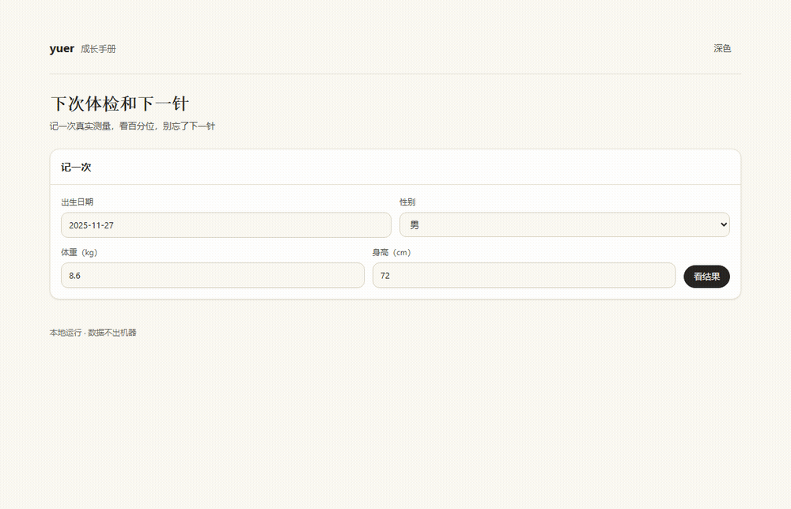
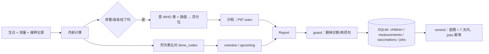

# yuer · 育儿成长与疫苗



记一次身高体重，看趋势，别忘了下一针。

## 功能特性

- **WHO 百分位**：男女分开的 0–60 月龄参考表，线性插值，输出 P3 / P50 / P97 与百分比
- **看趋势不看单点**：单次低于 P3 或高于 P97 只提示（`growth.weight_band` / `growth.height_band`），说明要连着三次看
- **疫苗计划**：22 个剂次、覆盖 0–60 月龄的国家免疫规划节选；`vaccine.overdue` 标逾期，`vaccine.upcoming` 标两个月内
- **到期提醒**：`remind` 汇总逾期与 7 天内到期，`jobs` 表按 key 幂等，同一天只发一条
- **CSV 导出**：`export` 出日期 / 体重 / 身高 / 疫苗 / 剂次，直接给医生
- **摘要守卫**：给家长的文案必须过 `guard`，出现"诊断 / 用药 / 可能是 / 疑似 / 推荐"整句丢弃

## 快速开始

```bash
uv sync --extra dev
uv run yuer growth --birth 2025-11-27 --sex boy --weight 9.6 --height 75.0
uv run yuer vaccine --birth 2025-11-27
uv run yuer note --birth 2025-11-27 --weight 9.6     # 给家长的一段话，过守卫
uv run yuer serve        # http://127.0.0.1:8022
```

实测 2025-11-27 出生、2026-11-27（12 月龄）测 9.6kg / 75cm：体重 P50.0、身高 P42.5，都在正常档；疫苗按生日推 12 月龄的水痘建议日期 2026-11-27。
本仓 33 条测试，行覆盖 85%。

## 为什么不用通用大模型直接问

问通用模型"12 个月 9.6kg 正常吗"，它给一个模糊判断，但：

1. **算不准**——百分位要查表 + 插值，它常凭印象给个"正常范围"；
2. **记不住月龄**——剂次严格按月龄排，它会把 8 月龄的麻腮风说到 12 月龄；
3. **分不清性别**——男女曲线不同，它默认混用；
4. **爱越界**——动不动给诊断和用药建议，这两件事这里一句都不许出。

yuer 把曲线表和剂次写在代码里，模型只负责把趋势写成带去门诊的问题清单，而且必须过守卫。

## 适用场景

- 0–5 岁孩子的家长；
- 需要按月龄追疫苗、怕漏针的人；
- 想给医生看趋势，而不是背一串数字的人。

## Roadmap

- [ ] 早产儿矫正月龄
- [ ] 多孩档案与切换（现在按 `child_id` 存，CLI 默认 1）
- [ ] 生长曲线图片导出
- [ ] 接种本拍照识别后回填

## FAQ

**问：数据从哪来？**
生长曲线取自 WHO Child Growth Standards (2006) 的 0–60 月龄节选，线性插值，属近似值；疫苗计划取自国家免疫规划节选。两者都不构成医疗建议，以接种门诊与儿保医生为准。

**问：为什么只提示、不给结论？**
单点测量受喂奶、排便、量法影响很大。这里只判断"这一档偏高/偏低"，并且每次都写"连着三次再看"，不替代医生。

**问：`remind` 会重复发吗？**
不会。key 是 `vaccine:日期`，写进 `jobs` 表，第二次直接返回"已提醒过"；要重发加 `--force`。

**问：旧版 0.x 的库怎么办？**
`yuer migrate --db data/yuer.db`：先备份成 `yuer.bak-时间戳.db`，把旧 `checks` 表转成孩子 + 测量记录。生日是按最后月龄反推的，迁完请核对一次。

## 命令参考

```bash
yuer growth --birth 2025-11-27 [--sex boy|girl] [--weight kg] [--height cm] [--on 日期] [--save] [--json] [--db 路径]
yuer vaccine --birth 2025-11-27 [--on 日期] [--json] [--db 路径]
yuer mark --code mmr --dose 1 [--on 日期] [--db 路径]
yuer note --birth 2025-11-27 [--weight kg] [--height cm]     # 过 guard 的一段话
yuer remind [--force] [--db 路径]                            # 逾期 + 7 天内，幂等
yuer export [--child-id 1] [--out records.csv] [--db 路径]
yuer migrate [--db 路径]
yuer serve [--port 8022] [--db 路径]
yuer doctor [--db 路径]                                      # 配置 / 数据库 / 疫苗表 / 模型 / webhook
```

## 依赖说明

运行时：`fastapi`、`uvicorn`、`jinja2`、`python-multipart`、`pydantic` + `pydantic-settings`（前缀 `YER_`）、`httpx`、`typer` + `rich`、`sqlalchemy` + `alembic`。
开发：`pytest`、`pytest-cov`、`ruff`（line-length 100）、`mypy`。
Python ≥3.10；镜像 `python:3.10-slim`，两阶段，`EXPOSE 8022`。

## 工作原理



规则全在 `domain/rules/` 与 `domain/guard.py`，存储与迁移在 `adapters/`，CLI/Web 只展示。

## 目录结构

```
yuer/
├── yuer/
│   ├── domain/          # models、engine、guard、summary、remind、rules/{percentile,vaccine}
│   ├── adapters/        # store.py（SQLAlchemy）、migrate.py
│   ├── iface/           # cli.py（Typer）、web.py（FastAPI + Jinja2）
│   ├── config.py        # YER_ 前缀配置
│   └── doctor.py
├── migrations/          # alembic env + versions/0001_init.py
├── templates/
├── tests/               # 28 条：插值 / 剂次 / 提醒 / 导出 / 守卫 / 迁移 / 接口
├── Dockerfile           # python:3.10-slim，EXPOSE 8022
└── .github/workflows/test.yml
```

## 作者

大钊 · GitHub [@wushiyi105-jpg](https://github.com/wushiyi105-jpg) · 17382987315
