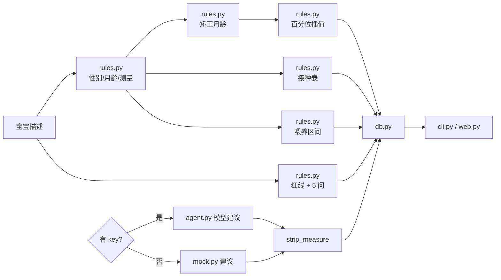

# 育儿 · 生长与喂养参考

[](https://github.com/wushiyi105-jpg/yuer/actions) []() [](./LICENSE) [](https://codecov.io/gh/wushiyi105-jpg/yuer)


> 给性别、月龄和身高体重头围:看百分位落在哪、下一针疫苗是什么、这个月怎么喂,红线症状直接标红。

家长最常问的两句是「**这个身高体重正常吗**」和「**下个月该打什么针**」。前者需要按月龄对照,后者需要按月龄排表,两件事都不该靠群里问人。这个工具把插值、矫正月龄、接种表和喂养区间放在本地算,只做参考与分流,不做诊断。

**CLI + Web,零第三方依赖。**

## ✨ 特性

- 📏 **生长百分位带** — 0/3/6/9/12/18/24 月锚点,按月龄线性插值,给出 P3 / P15 / P50 / P85 / P97 与本次落点
- 🧮 **早产矫正月龄** — `矫正月龄 = 实足月龄 − (40 − 出生孕周) ÷ 4`,小于 37 周才矫正
- 💉 **国家免疫规划 13 条** — 乙肝、卡介苗、脊灰、百白破、麻腮风、乙脑、流脑、甲肝、水痘,标出自费项
- 🍼 **5 段喂养区间** — 0–6 月纯奶、6–8 月泥糊、9–11 月末状、12–17 月三餐、18–24 月三餐两点
- 🚨 **7 条红线** — 3 月龄以下发热、抽搐、呼吸急促、精神差、持续呕吐、皮疹伴发热、误吞异物
- 🩺 **问诊 5 问** — 体温、精神、吃奶、尿量、持续时间,缺哪项标黄
- 🔒 **数值只认本地** — 模型只写解释,输出里的月龄、厘米、公斤、温度会被剥离
- ⚠️ **不做诊断** — 只给参考区间与分流,不给用药与剂量

## 🚀 快速开始

```bash
git clone https://github.com/wushiyi105-jpg/yuer.git
cd yuer

cp .env.example .env      # 可选:LLM_API_KEY

python -m yuer check --text "男孩,8个月,体重9kg,身高70cm,头围45cm"
```

也可以写进 `baby.txt`:`python -m yuer check --file baby.txt --save`。

Docker:

```bash
docker build -t yuer .
docker run -p 8000:8000 yuer
```

## 🤔 为什么不用通用大模型直接问

通用模型会说「8 个月男宝 9 kg 正常」。它给不出百分位,也不会告诉你下一针是 9 月龄的 A 群流脑。差别在四点:

1. **落点可复算** — `rules.interpolate()` 在 6 月(7.9 kg)与 9 月(8.9 kg)之间按 `8/3` 的进度插值得到 8.6 kg,再按离散系数给 P3 6.4 / P15 7.4 / P85 9.9 / P97 11.0。9 kg 落在 P15–P85,结论明确;模型只给「正常」两个字,既没有区间也无法复核。
2. **早产按矫正月龄** — 32 周早产、实际 8 个月,矫正月龄 6 个月,评估要用 6 月的标准。`rules.preterm()` 一行公式解决,模型经常忘掉这一步,直接把早产儿判成「偏小」。
3. **接种表按顺序排** — 8 月龄已到 8 剂、下一剂 9 月龄 A 群流脑第 2 剂、12 月龄水痘(部分自费)。这是表,不是生成内容;`data/milestones.json` 里 13 条写死,不会漏针也不会把自费说成免费。
4. **断网也能用** — 百分位、矫正、接种、喂养、红线、问诊清单全在本地;没有 key 只少解释那几句。

## 🎯 适用场景

- **儿保前自测**:先看三项落点,越界的只有一项就重点问那一项,不用到现场才翻手机。
- **早产儿随访**:按矫正月龄评估,避免拿足月标准吓自己。
- **不知道下个月打什么**:按月龄列出已到与接下来三剂,自费项单独标注。
- **添加辅食没把握**:6–8 月先铁米粉、一次一种、观察 3 天,直接照着做。
- **半夜发烧**:3 月龄以下直接红线,其余按 5 问把信息记全,第二天面诊不遗漏。

## 🗺 Roadmap

- **趋势曲线**:同一宝宝多次测量画曲线,看是否连续跨两条百分位线,而不是单点判断。
- **WHO 原表接入**:把估算带换成官方月龄别百分位表,并提供数据来源。
- **发育里程碑**:抬头、翻身、坐、爬、走的月龄区间与预警信号。
- **接种提醒**:按出生日期生成具体日期并推送,含补种方案。
- **喂养记录**:记录每日奶量与辅食种类,自动对照当月区间。

## ❓ FAQ

**百分位是官方数据吗?**
中位数参考 WHO 生长标准常用值,按月龄插值;百分位带由中位数乘离散系数估算,用于看趋势与是否越界,**不是官方百分位表**。诊断以儿保医生为准,这点在 `data/growth.json` 的 `note` 里写明。

**早产怎么算?**
`矫正月龄 = 实足月龄 − (40 − 出生孕周) ÷ 4`。32 周早产、实际 8 个月 → 矫正 6 个月;满 37 周不矫正。

**为什么 8 个月发烧不算红线?**
红线是「3 月龄以下发热 ≥38℃」,大月龄发热本身不等于急症;但精神差、呼吸急促、抽搐仍会单独触发红线。

**能给用药建议吗?**
不能。工具只做参考区间、接种表与分流,退热药按体重给药、是否用药请遵医嘱。

**模型会不会改数值?**
不会。`agent.strip_measure()` 把「8个月」「9kg」「45cm」「38度」替换成「相应数值」,数字只来自本地计算。

## 📖 命令参考

```bash
# 👶 评估
python -m yuer check --text "..."
python -m yuer check --file baby.txt --save

# 💉 接种表
python -m yuer vaccines

# 🍼 喂养区间
python -m yuer feeding

# 📏 查某月龄百分位带
python -m yuer growth --month 8 --sex boys

# 🗂 历史
python -m yuer history

# 🌐 Web
python -m yuer web --port 8000

python -m yuer --json check --text "..."
python -m yuer --mock check --text "..."
```

## 🔌 模型接入

兼容 **OpenAI `/chat/completions`** 的任意服务:

| 平台 | `LLM_BASE_URL` | `LLM_MODEL` |
|---|---|---|
| DeepSeek(默认) | `https://api.deepseek.com` | `deepseek-flash` |
| OpenAI | `https://api.openai.com/v1` | `gpt-4o-mini` |
| 本地 Ollama | `http://localhost:11434/v1` | `qwen2.5` |

## 🧠 工作原理

```
性别 / 月龄 / 身高体重头围 / 症状
  │
  ├─ rules.sex / age_months / measure
  ├─ rules.preterm ───── 孕周 <37 → 矫正月龄
  ├─ rules.interpolate 锚点插值 → P3–P97
  ├─ rules.classify ──── 落点分档
  ├─ rules.vaccines ──── 已到月龄 / 接下来三剂
  ├─ rules.feeding ───── 5 段喂养区间
  ├─ rules.red_flags ─── 7 条红线
  ├─ rules.questions ─── 问诊 5 问
  │
  ├─ 模型:解释 / 建议 / 风险(strip_measure)
  └─ 离线:mock.py 按分档与红线组装
  │
  └─ SQLite → CLI / Web
```

### 数据流



## 🗂 目录结构

```
yuer/
├── yuer/
│   ├── rules.py    # 性别、月龄、测量、早产、插值、分档、接种、喂养、红线
│   ├── agent.py    # 编排 + 数值剥离
│   ├── mock.py     # 离线建议
│   ├── db.py       # 评估记录
│   ├── cli.py      # check / vaccines / feeding / growth / history / web
│   └── web.py      # 单页 + JSON API
├── data/growth.json     # 锚点中位数 + 离散系数
├── data/milestones.json # 13 条疫苗 + 5 段喂养 + 7 条红线
├── tests/test_yuer.py
└── assets/demo.gif
```

## ✅ 测试

```bash
python -m unittest discover tests -v
```

34 个单测只测本地逻辑:性别与月龄解析、斤/公斤、早产与矫正、插值端点与中点、分档五种、接种与喂养边界、红线按年龄触发、离线全流程、数值剥离。CI 在 3.10/3.11/3.12 上跑。

## 👤 作者

小米 · 17612850106

## 📄 License

[MIT](./LICENSE)
